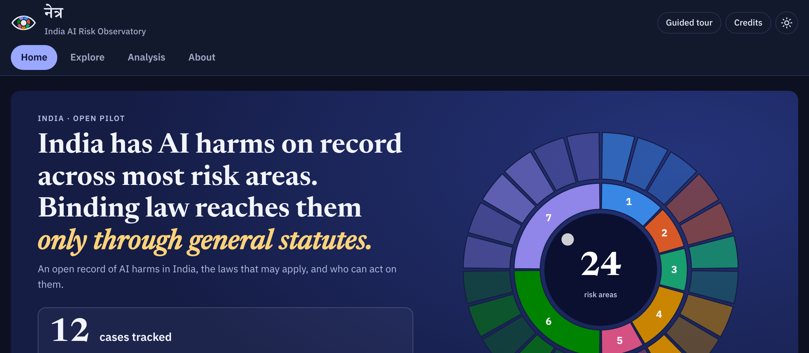

# NETRA India AI Risk Observatory

**🔗 Live site: https://krunal6649.github.io/netra-india-observatory/**  ·  Pilot v0.1 (open data, open code)

An open, India-focused map of AI risks, real incidents and the laws that apply to them. For each incident it shows what happened, which laws may apply, which authority could act, and what is still unknown, using NETRA, a 14-stage method for analysing AI harm.



## Who it is for
- **Lawyers and policy researchers:** find incidents, laws and gaps in one place, each with a source link.
- **Journalists and civil society:** see how deepfakes, voice cloning, fake citations and automated decisions map to Indian law.
- **Government bodies and regulators:** see where complaints currently have no clear authority, and tell us what is wrong or missing.

## Start here (three minutes)
1. Open the [live site](https://krunal6649.github.io/netra-india-observatory/) and press **Guided tour** (top right) for a five-step walk-through.
2. Go to **Explore**, switch between Risks, Incidents, Laws and Measures, and search. Click **Filters** to narrow the list.
3. Open an incident's **NETRA dossier** (under **Analysis**): location, laws that may apply, authority, and "what NETRA does not know".

## What is in it (pilot v0.1)
18 risks quoted from government frameworks · 22 documented Indian incidents · 28 laws, rules, advisories and court orders · 28 mitigation measures · 10 reporting authorities · 6 legal and policy gaps.

> **Status:** an independent research project. **Not legal advice.** All codings were drafted with AI assistance. The first 12 incidents were reviewed by the maintainer on 2026-10-25; the 10 added later (batch 2) are *unreviewed* until a person checks them. 24 legal items are still being verified against official texts (see CHANGELOG).

**Corrections:** use [Suggest a correction](https://github.com/krunal6649/netra-india-observatory/issues/new?template=correction.yml) (also linked at the bottom of every page). It asks only for a public source link, its date and the place. It is not for reporting live incidents, and nothing changes on the site until the maintainer reviews it. For financial cyber fraud, call 1930 or use cybercrime.gov.in.

**Cite as:** see `CITATION.cff`. Data: CC BY 4.0. Code: MIT. Risk taxonomies adapted from the MIT AI Risk Repository (CC BY 4.0), with credit; this project is not affiliated with MIT.

## How the site is organised

Four sections. Night (dark) mode is the default; the sun / moon button at the top right, beside **Guided tour** and **Credits**, switches to day mode. Printing always uses day colours. Each page has its own link, such as `#explore-laws` or `#analysis-dossiers`.

| Section | What it holds now |
|---|---|
| **Home** | Headline, one "cases tracked" counter (reviewed and unreviewed, with the data update date), then **Who to approach**: a drill-down directory (Level → Authority → Bodies → body page) of 31 Union bodies and 10 standard bodies for each of the 36 states and UTs, coloured by role (enforces, adjudicates, regulates, supports victims). States and UTs appear on a tile map of India that includes Jammu and Kashmir, Ladakh and Arunachal Pradesh. Then the risk wheel and where incidents outrun binding law |
| **Explore** | One searchable list with a switch: **Risks** (18 quoted from MeitY’s 2025 AI Governance Guidelines and NITI Aayog’s Responsible AI Part 1) · **Incidents** (22 documented in India) · **Laws** (28 statutes, rules, advisories, policy papers, standards and court orders, with Act numbers, Gazette notifications and cases where known) · **Measures** (28, sorted into MIT’s 23 mitigation types). Filters stay hidden until you click **Filters**. Incidents and laws show as a compact list (one line each, click to expand; a **List / Cards** switch keeps the full cards), can be sorted, show 20 at a time with **Show more**, and list active filters as chips you can remove. Incidents can also be filtered by state or UT, year and review status. Clicking the wheel opens one **risk area** with everything for it side by side |
| **Analysis** | **NETRA dossiers**: each incident through the 14 NETRA stages (location and jurisdiction, legal issues T1, authority routing, gaps T2–T3, unknowns, overclaim check) · **Gap register**: 6 gaps tied to incidents and instruments · **Report generator**: a plain report for any incident or risk area, built in the browser from the stored data with no AI; preview, copy, download as Markdown, or print / save as PDF. Each dossier, incident card and risk area has a **Generate report** button · **Model register**: 12 AI models; each card keeps what the testers found (METR, MITRE ATLAS) apart from NETRA's India analysis, with a Generate report button. **Add a report** (on Model register and Report generator) reads a PDF, Word, text or Markdown file in your browser only, and can make AI-assisted Extract, Triage and Draft notes with your own API key (unreviewed drafts) |
| **About** | **Method** · **Sources and credits** (every outside source and its licence) · **Verification status** (what has been checked against official texts and what is missing) · **Expert survey** · **Global evidence** (the three METR reports, mapped to Indian law) |

Links from v0.1 still work: `#navigator`, `#risks`, `#incidents`, `#governance`, `#mitigations`, `#netra`, `#gaps`, `#evidence`, `#survey` and `#about` open the matching new page.

## How the survey works

- **Anyone can take part.** Signed-in Contributors save answers directly. Everyone else (outside peers, public-link visitors, signed-out readers) clicks "Get my response code" and sends you the short code by email, WhatsApp or any message.
- **You import codes** in the owner-only box on the Expert survey page (About › Expert survey). Paste one or many at once; the same code imported twice counts once. Codes are checked, and anything with invalid values is rejected.
- Codes contain only survey answers, never a name or account.
- Nobody but you sees individual answers. Results go public only when you press "Publish aggregate", and show only once 5+ people have answered with consent.

## Run it on your own computer

Needs Python 3 only.

```
cd netra-india
python3 scripts/build.py          # checks data, writes dist/index.html
python3 -m unittest discover tests
node tests/smoke.js               # optional, needs Node.js
```

Open `dist/index.html` by double-clicking. Everything works offline except the survey, which needs the published version, and the fonts, which fall back to system fonts.

## Adding data

Edit `data/india.json` (incidents, instruments, risks, mitigations, gaps) or `data/authorities.json` (the Who to approach directory) and run the build. The build refuses:

- a risk without a verbatim quote and location
- an incident without an overclaim check and a "what we do not know" list
- NETRA stage 11 (human review) marked done on an unreviewed record
- unknown risk areas, sectors, instruments or authorities, and non-https sources
- a possible duplicate case: the same source or court document as an existing case, or a title 75% or more alike. If a person has checked that two look-alike cases really differ, list the other id in `distinct_from`
- a directory body with an unknown role, place, group or law, a non-https link, or "verified" without a link, checker and date; and any case whose reporting route does not lead to a body in the directory
- a missing or malformed `meta.updated` date (shown beside the home-page counter; change it whenever the data changes)
- a verification status other than yes / partial / no, or "yes" on a site home page instead of a specific document
- malformed Act numbers ("Act 45 of 2023"), Gazette notification numbers ("G.S.R. 139(E)", "S.O. 2351(E)"), dates, or case entries missing a citation, court, date, holding or verification note

`data/taxonomy.json` holds MIT’s taxonomies (keep the attribution line). `data/global_evidence.json` is the earlier METR pilot.

## AI-assisted drafts

Two ways, both producing **unreviewed drafts** that never change NETRA's data by themselves:

- **In the browser (anyone):** Analysis › Model register › **Add a report**. Your file is read in the browser only. If you
  use the AI steps, you paste your own key; a notice tells you the document goes straight from your browser to the
  provider you chose. The key stays in the tab's memory and is never stored or logged.
- **Owner-only workflow:** commit a `.txt`, `.md` or `.docx` file, then run **Actions › AI draft (unreviewed)**. It runs
  `scripts/ai_draft.py` and opens a draft pull request with `data/drafts/<date>-<title>.json`. Set it up once:
  add the repository secret `NETRA_AI_KEY` (optionally the variables `NETRA_AI_PROVIDER`, `NETRA_AI_MODEL`,
  `NETRA_AI_BASE`), and turn on *Settings › Actions › General › Allow GitHub Actions to create and approve pull requests*.
  Never put a key in the repository.

Safeguards in both: every quote must appear word for word in the source (and on the stated page), or it is removed;
sentences that read as a legal conclusion, an accusation or a review claim are removed; suggestions that do not match
NETRA's own lists of risk areas, laws and bodies are dropped; and the build refuses any draft marked reviewed.
The instructions and safeguard rules live in `scripts/ai_prompts.json`, shared by both.

## Verification to-do

1. Read official texts for every instrument marked "verify" (24 warnings in the build output; each note says what is missing).
2. Read the PSA white paper in full — it proposes a national AI incident database, which overlaps this project.
3. Capture primary evidence (court orders, public FIR details, platform notices) for each NETRA dossier.
4. Add risks from RBI FREE-AI recommendations 15–26, ICMR and SEBI.
5. Have a second coder check taxonomy and severity codes.
6. Check stage names against the NETRA v0.3 core workbook.
