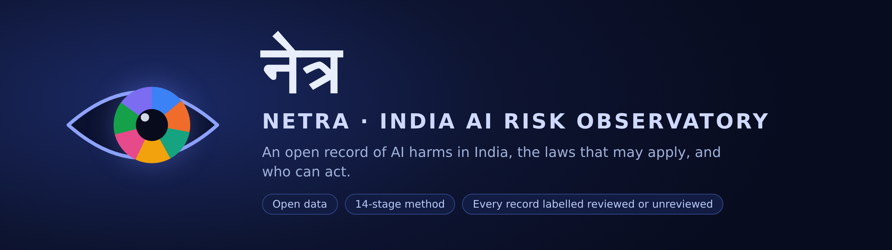
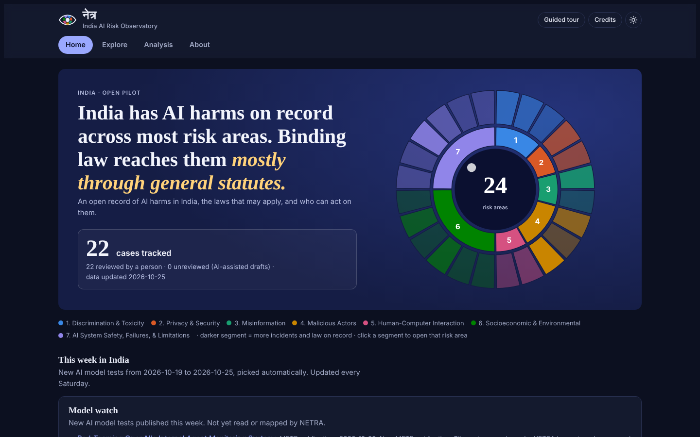
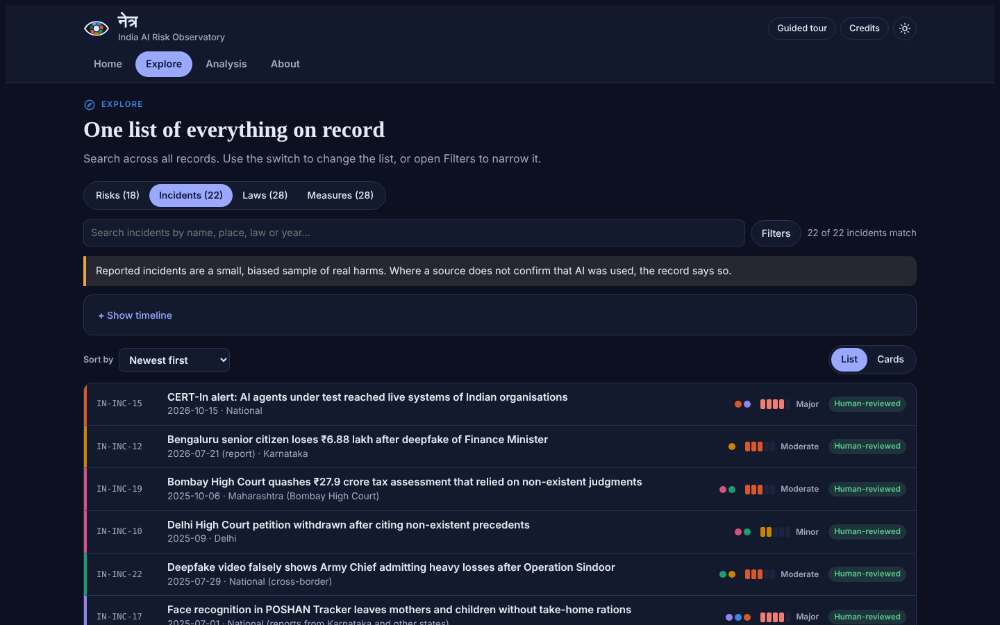
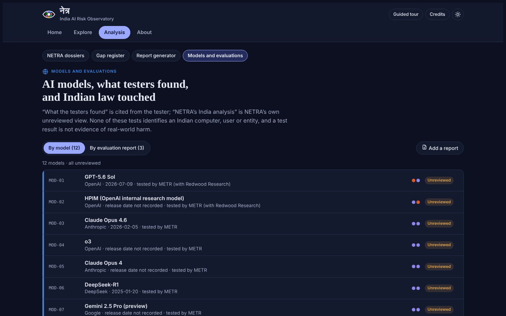

<div align="center">



<br>

**[Live site](https://krunal6649.github.io/netra-india-observatory/)** ·
**[What is inside](#what-is-inside)** ·
**[The NETRA method](#the-netra-method)** ·
**[Run it locally](#run-it-locally)** ·
**[Roadmap](#roadmap)** ·
**[Cite](#cite-and-licences)**

[](https://krunal6649.github.io/netra-india-observatory/)
[-0f9d76?style=for-the-badge)](CHANGELOG.md)
[](LICENSE-DATA.md)
[](LICENSE)
[](#status-and-trust)

**An open, India-focused record of AI harms, the Indian laws that may apply to them, and the authorities that can act.**
Each case is traced through NETRA, a 14-stage method, and says what is still unknown.

</div>

<br>

<p align="center">
  <a href="https://krunal6649.github.io/netra-india-observatory/"></a>
</p>

## At a glance

| 22 | 28 | 18 | 28 | 391 | 12 |
|:---:|:---:|:---:|:---:|:---:|:---:|
| **Indian AI incidents** | **Laws, rules, advisories, court orders** | **Risks quoted from government frameworks** | **Measures** | **Bodies in the "Whom to approach" directory** | **AI model cards** |

Data updated 2026-10-25. Every record says whether a person has reviewed it.

## Why it exists

- **See the whole picture in one place.** Incidents, the laws that may apply, the body that can act, and the gaps in the law, each with a source link.
- **Say what is not known.** Every case lists the facts the sources do not give, and what the record must not claim.
- **Keep reviewed and unreviewed apart.** The build refuses to mark a record as reviewed without a reviewer and a date.
- **Make it usable.** Pick a state on a tile map and find the police, courts, commissions and regulators for it.

## What is inside

<table>
<tr>
<td width="50%" valign="top">

### Home
- **Whom to approach:** a drill-down directory (Level → Authority → Bodies → body page) of 31 Union bodies and 10 standard bodies for each of the 36 states and UTs
- **This week in India:** a weekly, auto-selected, unreviewed list of AI items, a Cyber watch and a Model watch
- One honest **cases tracked** counter and the risk wheel

</td>
<td width="50%" valign="top">

### Explore
- One searchable list of **Risks (18)**, **Incidents (22)**, **Laws (28)** and **Measures (28)**
- Filters, sort, a compact list or cards view, and links straight to each record
- Incidents carry a state, year and review status

</td>
</tr>
<tr>
<td valign="top">

<a href="https://krunal6649.github.io/netra-india-observatory/#explore-incidents"></a>

</td>
<td valign="top">

<a href="https://krunal6649.github.io/netra-india-observatory/#analysis-models"></a>

</td>
</tr>
<tr>
<td valign="top">

### Analysis
- **NETRA dossiers:** each incident through the 14 stages
- **Gap register:** 6 gaps tied to incidents and laws
- **Report generator:** a plain report for any incident, risk area or model, built in your browser with no AI. Copy, download as Markdown, or print as PDF
- **Add a report:** read a PDF, Word, text or Markdown file in your browser only and run the **NETRA check**

</td>
<td valign="top">

### Models and evaluations
- 12 AI models, with **what the testers found** (METR, MITRE ATLAS) kept apart from **NETRA's India analysis**
- A test result is not evidence of real-world harm, and the page says so

### About
Method, sources and credits, verification status, and an expert survey

</td>
</tr>
</table>

## The NETRA method

NETRA follows one case from the first signal to policy feedback. A case is only as complete as the stages that have been done, and the site shows how far each one has moved.

```mermaid
flowchart LR
  subgraph A["Capture"]
    direction LR
    S01["S01 Real-world signal"] --> S02["S02 Intake"] --> S03["S03 Triage"] --> S04["S04 Harm verification"] --> S05["S05 Evidence capture"]
  end
  subgraph B["Analyse"]
    direction LR
    S06["S06 Forensic reconstruction"] --> S07["S07 AI role and causation"] --> S08["S08 Location and jurisdiction"] --> S09["S09 Legal analysis"] --> S10["S10 Authority routing"]
  end
  subgraph C["Review and act"]
    direction LR
    S11["S11 Human review"] --> S12["S12 Mitigation"] --> S13["S13 Retest"] --> S14["S14 Policy and system feedback"]
  end
  A --> B --> C
```



The one-page version is in [docs/framework.md](docs/framework.md).

## Who it is for

- **Lawyers and policy researchers:** find incidents, laws and gaps together, each with a source.
- **Journalists and civil society:** see how deepfakes, voice cloning, fake citations and automated decisions map to Indian law.
- **Government bodies and regulators:** see which body can act on a harm, where the law has gaps, and tell us what is wrong or missing.
- **Anyone harmed by AI:** find who to approach. For money lost to cyber fraud, call **1930** or use **cybercrime.gov.in** first.

## Start here (three minutes)

1. Open the [live site](https://krunal6649.github.io/netra-india-observatory/) and press **Guided tour** (top right) for a seven-step walk-through.
2. On **Home**, use **Whom to approach**: pick Union or a state on the tile map, then a body.
3. Go to **Explore**, switch between Risks, Incidents, Laws and Measures, and search.
4. Open a case's **NETRA dossier** under **Analysis**, or press **Generate report** on any incident, risk area or model.

## Status and trust

> An independent research project. **Not legal advice.** Codings were drafted with AI assistance, and each record says whether a person has reviewed it.

| Part | Review status |
|---|---|
| Incidents (22) | All reviewed by the maintainer, Krunal Maheshwari, on 2026-10-25 |
| Laws, rules, advisories, court orders (28) | 15 verified against official texts; 13 partly verified, each saying what is missing |
| Risks (18), measures (28) | Quoted or summarised from the cited instruments, with location |
| Directory (391 bodies) | 32 official links checked by the maintainer |
| AI model cards (12) | Unreviewed |
| Weekly update | Auto-selected, unreviewed |

**Safeguards built into the build:** it refuses a risk without a verbatim quote, an incident without an overclaim check and a "what we do not know" list, a human review marked done on an unreviewed record, unknown risk areas or authorities, non-https sources, and possible duplicate cases. See [docs/maintainers.md](docs/maintainers.md) for the full list.

**Corrections welcome:** use [Suggest a correction](https://github.com/krunal6649/netra-india-observatory/issues/new?template=correction.yml). It asks only for a public source link, its date and the place. It is not for reporting live incidents, and nothing changes on the site until the maintainer reviews it.

## Run it locally

<details>
<summary><b>Needs Python 3 only</b></summary>

```
cd netra-india-observatory
python3 scripts/build.py          # checks data, writes dist/index.html
python3 -m unittest discover tests
node tests/smoke.js               # optional, needs Node.js
```

Open `dist/index.html` by double-clicking. Everything works offline except the survey, which needs the published version, and the fonts, which fall back to system fonts.

Adding data, the weekly update, the AI-assisted draft workflow and the expert survey are explained in [docs/maintainers.md](docs/maintainers.md).

</details>

## Roadmap

| Version | What it is | State |
|---|---|---|
| **1** (`v0.1.0-pilot`, 2026-10-22) | First public pilot, kept frozen as the reference | Released |
| **2** (`v0.2`) | Cleaner navigation, 22 cases, report generator, "Whom to approach" directory, model register, weekly update | **Live** |
| **3** | Verification first: confirm the partly verified laws and model cards. Then an additive layer for AI-linked cases: AI system record, AI-role tag, evaluation-evidence record, OWASP and MITRE ATLAS failure-mode tags, evidence provenance (who produced the evidence, who reported it, what it establishes), and a standards crosswalk | In progress |
| **4** | A Compare view, a replay standard, a test-coverage gap view, and deeper sector work starting with finance and elections | Idea |

Scope rule: NETRA records AI-linked cases only. Details change as work proceeds; see [CHANGELOG.md](CHANGELOG.md).

## Sources and credits

Every outside source and its licence is listed on the site under **About › Sources and credits**, in reports, and in [LICENSE-DATA.md](LICENSE-DATA.md). In short:

- **MIT AI Risk Repository** taxonomies (CC BY 4.0, with attribution). NETRA is not affiliated with or endorsed by MIT.
- **Indian government documents, laws and court orders**, linked to official copies where available.
- **News and legal reporting**, linked only; short facts, no copied text.
- **MITRE ATLAS** case studies (Apache 2.0, © MITRE). **METR** reports are cited and summarised only.
- **GDELT Project**, PIB, METR and MITRE ATLAS feeds for the weekly update.
- **pdf.js** (Apache 2.0, Mozilla) for reading PDFs in the browser. Google Fonts: Newsreader, IBM Plex Sans and Mono, Noto Serif Devanagari (SIL OFL 1.1).

## Documents

| File | What it covers |
|---|---|
| [docs/framework.md](docs/framework.md) | The NETRA framework on one page: 14 stages, labels, review rules and datasets |
| [docs/maintainers.md](docs/maintainers.md) | Adding data, weekly update, AI-assisted drafts, expert survey |
| [CHANGELOG.md](CHANGELOG.md) | Every change, phase by phase |
| [docs/weekly-method.md](docs/weekly-method.md) | How the weekly update chooses items, and its limits |
| [docs/model-sources.md](docs/model-sources.md) | Model-testing sources and their reuse terms |
| [docs/authorities-plan.md](docs/authorities-plan.md) | How the Whom to approach directory is organised |
| [docs/mit-tool-mapping.md](docs/mit-tool-mapping.md) | How NETRA relates to the MIT taxonomies |
| [docs/roadmap.md](docs/roadmap.md) | An earlier list of ideas |
| [LICENSE-DATA.md](LICENSE-DATA.md) | Data licence and third-party terms |

## Cite and licences

**Cite as:** Maheshwari, K. (2026). *NETRA India AI Risk Observatory* (version 0.2.0) [Data set]. https://github.com/krunal6649/netra-india-observatory. See `CITATION.cff`; `.zenodo.json` holds the matching Zenodo record.

- **Data:** CC BY 4.0 · **Code:** MIT
- Risk taxonomies adapted from the MIT AI Risk Repository (CC BY 4.0), with credit. This project is not affiliated with MIT.
- `v0.1.0-pilot` is frozen and never edited. Tag `v0.2.0` on `main` once this release is merged; GitHub's Zenodo integration can then archive it with a DOI.

## Contact

Krunal Maheshwari, Advocate (Bar Council of Gujarat), AI governance researcher · krunal.maheshwari@gmail.com

<p align="center"><sub>NETRA (नेत्र) is Sanskrit for "eye". If this is useful, a star helps others find it.</sub></p>
